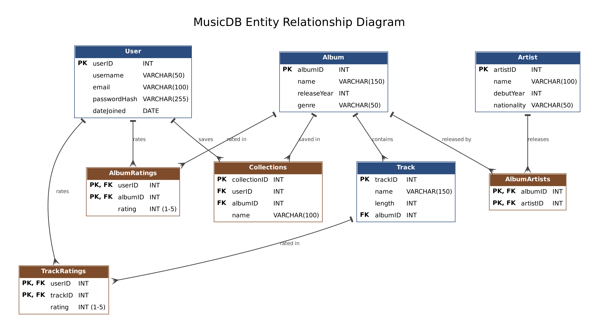

# MusicDB: Album Collection & Recommendation Database

A relational database for music fans to save albums into collections, rate albums and individual tracks, and get album recommendations based on their favorite genre.

**Built with:** SQL (MySQL 8.0.16 or newer; window functions and enforced `CHECK` constraints require it)
**Author:** [ryanc-lppm](https://github.com/ryanc-lppm)

---

## Purpose

MusicDB stores albums, tracks, artists, and genres that users save to their collections. Users rate albums and tracks, and the database uses those ratings to help them discover new music that fits their taste.

## Questions the database answers

| Question | View |
|---|---|
| What albums has a user saved? | `vw_user_saved_albums` |
| What is the average user rating for each artist? | `vw_avg_artist_rating` |
| What album should be recommended based on a user's favorite genre? | `vw_recommend_by_genre` |
| Which genre has the highest rated albums? | `vw_genre_avg_rating` |
| What is the highest rated album in each genre? | `vw_highest_rated_album_per_genre` |
| What is the highest rated track in each album? | `vw_highest_rated_track_per_album` |

## Schema (8 tables)

| Table | Description |
|---|---|
| `User` | Account info (username, email, password hash, date joined) |
| `Artist` | Name, debut year, nationality |
| `Album` | Name, release year, genre |
| `Track` | Name, length (seconds), belongs to one album |
| `AlbumArtists` | Junction table for the many-to-many between albums and artists |
| `Collections` | Albums a user has saved, grouped under a collection name |
| `AlbumRatings` | A user's 1-5 rating of an album |
| `TrackRatings` | A user's 1-5 rating of a track |



## Design highlights

- **Many-to-many modeling:** albums and artists are linked through the `AlbumArtists` junction table, since an album can have several artists and an artist can release many albums.
- **Duplicate prevention:** composite primary keys on `AlbumRatings` and `TrackRatings` stop a user from rating the same album or track twice.
- **Data integrity:** foreign keys with `ON DELETE CASCADE` / `ON UPDATE CASCADE`, `NOT NULL` and `UNIQUE` constraints, and `CHECK (rating BETWEEN 1 AND 5)`.
- **Indexes** on frequently joined and filtered columns (`Track.albumID`, `Collections.userID`, `Collections.albumID`, `Album.genre`).
- **Advanced SQL in the views:** CTEs, `ROW_NUMBER() OVER (PARTITION BY ...)`, aggregates, multi-table joins, and a `LEFT JOIN ... IS NULL` to exclude albums a user has already rated.
- **Constraint testing:** `constraint_tests.sql` deliberately inserts invalid data (a track for a nonexistent album, a rating of 10, a duplicate rating, a duplicate username, a rating from a nonexistent user, a missing album name) to confirm each rule rejects it.

## Seed data

Sample data includes 9 users, 43 artists, 49 albums, and 98 tracks, along with collections and ratings. All users are fictional.

## How to run

Run the files in this order. Each one selects the `MusicDB` database, and `schema.sql` creates it first.

1. `schema.sql` creates the database, tables, and indexes
2. `seed_data.sql` loads the sample data
3. `views.sql` creates the six views
4. `constraint_tests.sql` (optional) runs inserts that should all fail with errors

Then try:

```sql
SELECT * FROM vw_user_saved_albums;
SELECT * FROM vw_recommend_by_genre;
SELECT * FROM vw_highest_rated_album_per_genre;
```

## Known limitations and future improvements

- **Collections design:** each row stores one album in one collection, so the collection name repeats. A better design is a `Collections` table plus a `CollectionAlbums` junction table.
- **Genres:** genre is a text column on `Album`. A `Genre` table with a many-to-many relationship would handle albums that span several genres.
- **Recommendations:** the view matches on a single favorite genre (ties are broken by how many albums the user rated in it) and returns every unrated album in that genre. It could rank results by the average rating from other users.
- **Passwords:** this is a database-only project, so the seed data uses placeholder values in `passwordHash`. A real application should store salted hashes produced by a proper algorithm such as bcrypt, never plaintext.
- **Application layer:** a planned next step is a small Java or C# program that connects to the database and shows a user their recommendations.

## Skills demonstrated

Relational database design, normalization, ER modeling, SQL DDL/DML, views, joins, CTEs, window functions, data integrity constraints, and testing.
